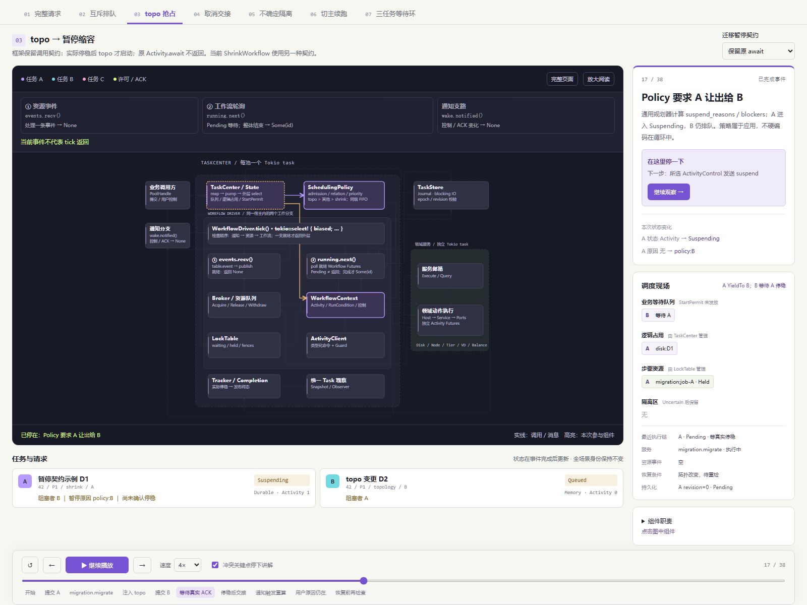

# Runtime Lab：请求流转与冲突交接动态演示

## 目的与验收标准

用户需要看到请求从发出到被各组件处理的过程，以及遇到冲突后谁决定等待、谁持有占用、
谁发起取消或暂停、何时可以交接。静态架构图无法替代这一演示。

在原地址升级：[打开动态演示](../diagrams/task-center-simulation/index.html)。



基于实现 `53fae88`，视觉参考 [Temporal 官网](https://temporal.io/) 的技术产品展示方向，
使用浅色页面、紫色强调、深色运行画布和高对比消息。未复制商标、图片或业务能力声明。

| 验收标准 | 表现 |
| --- | --- |
| 请求沿真实职责链移动 | 提交、策略、defer、许可、poll、Acquire、服务 Execute、结果、reap |
| 分清独立执行宿主 | 每池 TaskCenter 一个 Tokio task；Driver 嵌入；各领域服务独立宿主 |
| 看见业务排队与阻塞者 | Task 卡片、队列位置、blockers、逻辑占用与步骤资源同时显示 |
| 冲突不能提前释放占用 | FIFO、CancelThenWait、真实 ACK 前等待、不确定结果隔离 |
| 两种暂停语义可对比 | 同场景下切换保留 await / 停稳后返回部分结果 |
| 用户原因独立 | topo 完成仍保留 user；resume 后还需 guard 条件检查 |
| 请求与 Task 区分 | 登记前显示请求，登记后才显示 Task 身份；后续始终保持该身份 |
| 可操作且可读 | 播放、暂停、前后单步、跳转、倍速、关键点讲解、组件查询、专注模式 |
| 离线可打开 | 原生 HTML/CSS/JS/SVG，无外部依赖或网络请求，不执行真实存储 |

## tick 分支

画布上方随事件标出正在推进的分支，图内分开显示 ① events.recv 与 ② running.next；
另列控制通知 wake.notified。Pending、普通 Waker 唤醒、None 和 Some(TaskId) 分别标注。
详见 [本次更新与验证](2026-10-24-driver-tick-views.md)。

## 场景

1. **完整请求**：当前 OnlineDisk 的五次 Activity：Tier Inspect → Node Inspect → Add → Open → SetIo。
   逐步展开资源事件、Permit 唤醒、再次 poll、服务执行、Guard 结算与 Release 消费。
2. **互斥排队**：两个自定义维护流程争用 D1，策略 Exclusive；无关 D2 任务可先行。
   维护命令是策略教学用例，不宣称新增了生产领域命令。
3. **topo 抢占缩容**：迁移在途时 B 到达；策略暂停 A，等待真实 ACK 后才放行 B。
   用户另加暂停原因；topo 结束不清除 user；恢复前 guard 检查条件。两种契约下最终 Activity 数为 1 / 2。
4. **取消交接**：同盘下线请求取消在 Open 中的上线。演示省略此前上线步骤，强调已接受动作停稳后再交接。
   场景结束于后继获得执行权，不假装尚有占位步骤的下线业务已成功完成。
5. **不确定隔离**：外部效果无法确认，步骤与逻辑对象保留隔离；后继 StartPermit 被拒绝，没有 Activity。
6. **切主续跑**：在旧执行已停稳、checkpoint 已保存的前提下，新主完成外部 fencing 与领域恢复，
   再 claim / 预检 / CAS 接管 / 安装全部任务 / guard / 续跑。新 owner=43，原 TaskId 不变。

7. **三任务等待环**：运行缩容 A、先到卷任务 C、后到 topo B。先展示旧 FIFO 反例，
   再展示当前 priority 移除 B → C 的等待边；B 仍等待 A 停稳 ACK。
   A 恢复后完成排空检查、关 IO、移除成员，最后 C 获得执行权。
   该轨迹含 8 次缩容 Activity（迁移停稳返回后重入一次），对齐 Rust 三任务回归用例的执行次序。

## 动画与状态的契约

这是一组确定性教学快照，不是 Rust 调度器、真实日志回放或监控。
TaskId 使用可读缩写（轮次 / P1 / 业务 / 字母流水），不是实际 TaskId 序列化文本。
教学场景的等待者、命令耗时和控制到达顺序固定；真实执行允许不同合法交错。

移动中的消息解释正在发生的事件；任务、资源与队列面板保持上一个已完成事件状态，
消息到达后统一更新。暂停播放器会保留消息位置，前后单步或跳转恢复确定状态。
播放器暂停不等于给业务发送 suspend。关键点讲解默认开启，可关闭观察完整连续播放。

一个 poll / pump 中的同步微步骤可以拆成多帧，用于说明先后约束，不代表新增异步边界。
资源表、服务状态和 Future 面板是示意；服务框汇总本帧涉及的宿主，Future 展示最近执行链，
不代表系统只有一个 Future 或所有领域共享一个服务宿主。

未展示的能力不据此推断：没有自动重试、自动解隔离或确定性重放。
双任务暂停页是框架契约对比，只展开迁移片段；原调用保留模式不是当前 ShrinkWorkflow 的实现。
当前缩容使用 ActivityExit::Suspended 和 RunCondition。三任务页演示它的完整业务阶段。
其中 B/C 沿用回归测试的可控 Workflow 来展示调度，不冒充完整下线/建卷业务。
磁盘资源集合用 disk:D1+D2 简写；BalanceHost::resources 返回空集合，逻辑磁盘冲突归 TaskCenter。
保留 await 的对比示例仍持有自定义步骤资源；不能据此绕过同资源读写锁。
切主场景不模拟任意崩溃点；远端效果不确定时必须对账，TaskStore fencing 不替代数据面 fencing。

## 文件与验证

- scenario.js：7 个场景入口、8 组轨迹、346 个不可变事件快照。
- app.js：requestAnimationFrame 播放、沿 SVG 路径移动、状态差异、任务/队列渲染。
- index.html / styles.css：固定组件拓扑、Temporal 风格参考、响应式与减少动态效果支持。
- scripts/verify-task-center-simulation.mjs：语义断言和 Chrome 实际交互测试。

```sh
node scripts/verify-task-center-simulation.mjs
node scripts/verify-task-center-simulation.mjs --browser --screenshot preview.png
```

Node 22+，浏览器测试使用本机 Chrome；CHROME_PATH 可覆盖位置。使用独立临时浏览器 profile，
不读取用户浏览器会话；测试完成关闭自身进程。截图可选。

## 验证记录

- 全部 346 个事件的对象/资源、等待、身份、ACK 和恢复约束断言通过。
- Chrome：逐事件状态对照、实际自动播放、关键点自动停留、消息暂停/继续、完整播放与重播、
  模式切换、时间线、章节、键盘、组件说明、SVG 文字边界、移动端、减少动态效果与离线检查通过。
- 实际查看冲突场景截图，调整专注播放布局，确保消息路径与阻塞信息可辨认。
- `node scripts/verify-unified-task-guide.mjs` 通过，原静态指南仍可独立使用。
- 外围 `npm run verify` 通过（Harness、lint、TypeScript、生产构建）。
- 本次不修改 Rust 行为，Rust 测试沿用实现提交证据。

此前单请求动画说明保留为历史记录：[2026-10-22 版本](2026-10-22-task-center-simulation.md)。
