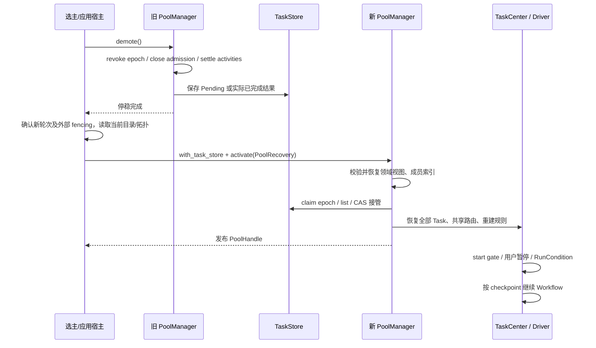

# 主备切换：正式 Pool 入口

本页对应 `PoolManager::activate` / `demote`，不绕过 PoolHandle 直接提交测试 Workflow。

## 运行

```sh
cargo run --locked -p storage-pool --example leader_handoff
```

示例使用真实 `FileTaskStore`，旧宿主释放后重新打开日志；元数据、数据面和迁移模块使用模拟适配器。
日志输出文件位于系统临时目录，示例结束后保留以供检查。两个主轮次为示例明确提供的 11 和 12。

1. epoch 11 通过正式激活入口创建池，并通过 PoolHandle 创建层级、节点、硬盘和 VD。
2. 提交缩容，在迁移实际进度至少为 2 后暂停，等待停稳和 checkpoint 保存。
3. 旧主 demote：撤销轮次、拒绝新请求、等待所有已派发动作结束。任务保存为 Pending，而非用户取消。
4. 新主 epoch 12 重开任务日志，恢复领域视图、成员索引和同一 TaskId。用户暂停和 checkpoint 保留。
5. 模拟切换期间目标盘 IO Down。用户 resume 后停在 WaitingConditions，不发起迁移。
6. 通过正常 online_disk 流程恢复条件，再继续原任务，最终移除目标盘。迁移共调用两次。
7. 验证旧主记录写入被拒绝，新任务使用 epoch 12，旧任务保持 epoch 11 的原 ID。
   通过 detach_node 验证恢复的路由和成员索引也已清理。

## 注入点与调用顺序

```rust,ignore
let manager = PoolManager::new(config, metadata, data_plane)
    .with_task_ids(TaskIds::for_leader(elected_epoch)?)
    .with_task_store(task_store) // Arc<dyn TaskStore>，具体实现由应用选择
    .with_balance(balance);

let pool = manager.activate(recovery).await?;
let run = pool.shrink(request).await?; // 此入口自动声明 Durable
// 失去主身份时：
manager.demote().await?;
```

`PoolRecovery` 包含稳定的 PoolDescriptor、完整节点状态和层级目录。Disk/VD 元数据从
MetadataStore 的权威读取接口重新载入，不能从 Workflow checkpoint 推测领域状态。
新池使用 `PoolRecovery::empty(CreatePool)`，同样经过持久化装配。
未配置 TaskStore 的现有 `create/create_pool` 内存路径保留；配置了存储后该同步旁路明确拒绝，
必须通过异步 activate 完成恢复后才暴露句柄。其他未声明 Durable 的业务仍为内存任务。



TaskCenter 在索引发布的同一临界区内构造，登记前无业务执行；恢复后的成员清理与普通提交使用
同一 Pool 所有权对象。激活期间预约 Pool 的 ID/UUID/名称，避免两个并发激活发布重复宿主。
元数据、任务恢复或身份校验失败时不发布 PoolHandle；预约随失败/取消释放。

## 失败与边界

- `demote` 不设置用户取消标记；在途动作仍须真实结束。已完成业务保留 Completed，结果不确定保留 NeedsCheck。
- 未暂停的 Pending 任务恢复后自动重新准入；用户暂停的任务必须由用户 resume。
- TaskStore 拒绝重复/更旧的主轮次。接管为逐条 CAS；接管后失败不回滚记录。
  若本轮 claim 已执行或结果不确定，重新激活应使用选主系统授予的更新轮次。
- 未定义的 Workflow、NeedsCheck、未确认结束的用户取消会阻止自动激活，需要外部核对，不能跳过。
- 当前不实现选主算法，也不自动分配持久化主轮次。外部必须保证轮次递增并隔离旧主的数据面效果。
  本地 revoke 和 TaskStore epoch 仅控制当前进程执行及任务记录，不能替代远端数据面的 fencing。
- `recovery_snapshot()` 方便受控交接和示例使用，需要先停止拓扑变更；它不是原子快照或持久化目录。
  旧主宕机时，新主从外部目录和当前拓扑观测构造 PoolRecovery，不依赖旧主还能响应。
- FileTaskStore 是单主机文件后端，演示两个宿主顺序接管。多机主备应注入共享且支持 fencing/CAS 的存储实现；
  本示例没有模拟真实机器断电，也没有生产 C 数据面或生产元数据适配器。

## 验收与验证

| 验收要求 | 验证入口 |
| --- | --- |
| 正式 PoolHandle 缩容持久化并跨宿主恢复 | `examples/leader_handoff.rs` 的实际运行及 example test |
| 用户暂停、checkpoint、原 TaskId 保留 | 文件关闭重开后查询、恢复暂停确认与迁移进度断言 |
| 条件变化先重新准入 | WaitingConditions 时迁移调用次数不增加，正常上线流程完成后继续 |
| 运行中失主可自动恢复 | `tests/leadership.rs::demoting_active_migration_restores_same_task_without_user_resume` |
| 旧主不可写、新任务 ID 不回退 | 示例 stale save 拒绝、新任务 epoch 12 |
| 重复激活、旧轮次、错误拓扑不发布池 | leadership 集成测试 |
| 恢复成员索引与清理 | 恢复后 online_disk、缩容后 detach_node 均经正常业务入口 |

实现涉及 `manager/leadership.rs` 的装配与交接、`pool.rs` 的两阶段构造、领域服务初始状态载入、
恢复缩容的 Pool 成员清理依赖和 TaskCenter 的共享路由注入。基础库持久化协议和存储格式保持不变。

2026-10-25 本机验证记录：

- `scripts/verify.ps1 -Toolchain stable-x86_64-pc-windows-gnu -Offline` 通过：153 个 Rust 测试
  （含文件交接 example test）、所有 example 编译、文档测试、rustfmt、Clippy `-D warnings`。
- `leader_handoff` 直接运行通过：保存迁移进度 2、epoch 11→12、原 TaskId 保留、WaitingConditions
  阻止迁移、恢复后第 2 次迁移调用完成、磁盘和成员路由清理。
- 新增并发目录变更回归：激活期间已有池重命名，不会被新池发布覆盖；激活可在 tokio::spawn 中运行。
  该测试暴露并修复了 Driver 恢复辅助函数跨 await 持有共享借用导致 Future 非 Send 的问题。
- 首次演示等待条件误匹配了阶段进度；已改为同时要求 migrating 和已复制进度，并断言保存进度至少为 2、
  切换前后实际有两次迁移调用，避免把迁移尚未开始的排队恢复当作迁移中交接。
- 外围 `npm run verify`、`git diff --check` 通过。
