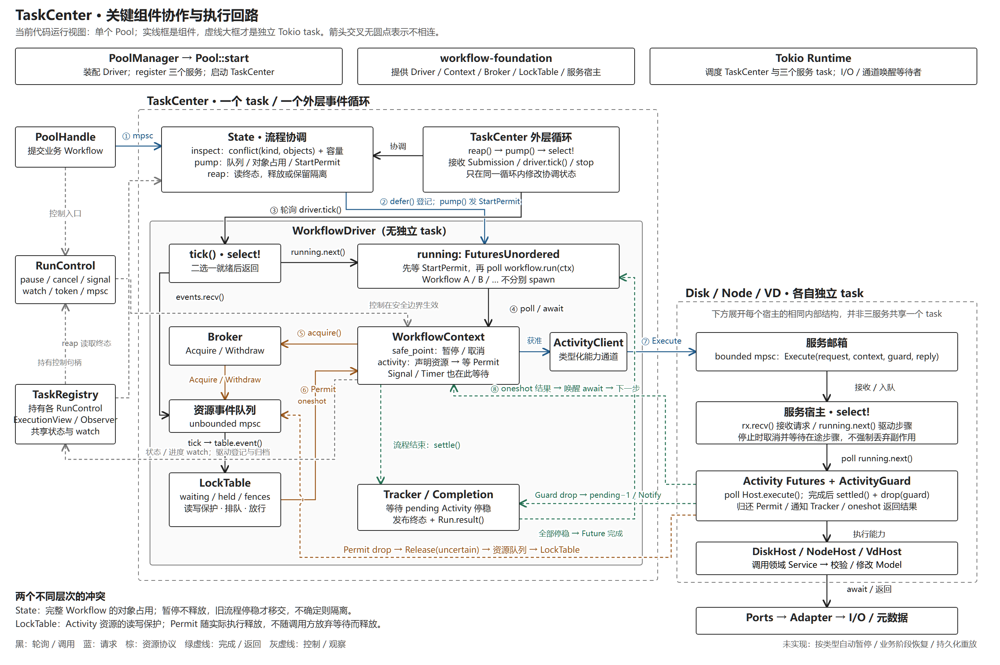

# TaskCenter 关键组件协作图（历史版本）

本图基于旧实现 7b3b408，仅作历史索引。最新的统一 Task、策略调度、两种暂停与恢复机制见[六图运行导读](runtime-guide.md)。

一张图展示当前 Pool 的关键组件、实际驱动关系、消息管道、资源申请与释放、控制与完成回路。
基于实现版本 `7b3b408`，2026-10-21 核对；此次仅增加文档，不改变执行语义。

[可缩放版本](diagrams/task-center-collaboration.html) · [SVG 原图](diagrams/task-center-collaboration.svg)

## 顺着一次执行阅读

1. PoolHandle 经有界提交队列进入 TaskCenter。外层循环检查 State 的流程类型、对象冲突和容量；被拒绝的请求不会取消旧流程。
2. 同步调用 driver.defer() 登记 Future 和 RunControl。State 保存 StartPermit，满足对象占用条件时才放行；不是把 Workflow 投递到另一个执行宿主。
3. TaskCenter 轮询 driver.tick()。tick 的 select 同时等待资源队列与 running.next()；后者轮询 FuturesUnordered 中就绪的 Workflow Future。等待 I/O 的流程不会阻塞其他流程推进。
4. WorkflowContext.activity() 经安全边界检查，调用服务适配器声明的 resources()，通过 Broker 发 Acquire。Driver 收到事件后调用 LockTable.event()，更新 waiting/held/fences 并尝试放行；通过 oneshot 返回 Permit。
5. 获得 Permit 后，Tracker 注册 ActivityGuard；ActivityClient 把请求、取消上下文、Guard 与回复通道放进目标服务的邮箱。
6. 领域服务自己的宿主循环接收请求，将执行 Future 放入其 FuturesUnordered，轮询 Host.execute()，再调用领域 Service、Model 和外部端口。
7. 实际执行结束后，Guard 记录结果并释放：通知 Tracker、投递资源 Release 事件；另以 oneshot 返回步骤结果。Driver 再次轮询时，Workflow 才能根据结果继续下一步。图中返回线是逻辑返回关系，不表示响应发送方直接执行 Workflow。
8. Workflow 结束时还需等待 Tracker 中在途 Activity 停稳，再发布终态与 Run.result()；Driver 归档完成任务。下一轮 State.reap()/pump() 释放对象或保留隔离，放行后继。

## 不要混淆的边界

- TaskCenter 是一个独立 task；Driver、LockTable、Broker、State 均不是额外 task。三个领域服务各有独立宿主，图右侧只展开一次同构结构。
- TaskCenter 的 State 管完整流程的对象占用与业务冲突；当前 Pool 的托管流程不会再向 LockTable 申请重复的 Workflow 对象锁。LockTable 在这条路径上管 Activity 资源读写保护。
- Broker 是资源事件发送端；Permit 持有其发送能力，Drop 时投递 Release，不直接改 LockTable。LockTable 只由 Driver 所在循环更新。
- 暂停是安全边界上的协作式暂停，不抢占已执行的 Activity，且不释放流程对象占用。取消令牌会传递到 ActivityContext，仍要等待实际步骤停稳。
- TaskRegistry / ExecutionView / RunControl 是共享登记、观察与控制机制，不是另一个调度器。图中的状态线概括共享句柄和 watch，不能当作持久化事件日志。
- 观察 Query 复用服务邮箱，直接读取服务确认的视图，不走 Workflow 的 Activity 准入链；为突出主执行闭环未单独画线。
- 按类型自动暂停、业务阶段触发恢复、持久化历史和确定性重放尚未实现；示例端口使用内存/模拟适配器。

## 源码对应

- [Pool 装配](../crates/storage-pool/src/pool.rs)
- [TaskCenter 外层循环与 State](../crates/storage-pool/src/task_center/mod.rs)
- [业务冲突判断](../crates/storage-pool/src/task_center/conflicts.rs)
- [WorkflowDriver / ExecutionView / StartPermit](../crates/workflow-foundation/src/driver.rs)
- [Broker / LockTable / Permit](../crates/workflow-foundation/src/locks.rs)
- [Context / Tracker / ActivityGuard / Completion](../crates/workflow-foundation/src/workflow.rs)
- [ActivityClient 与服务宿主](../crates/workflow-foundation/src/service.rs)

## 验收与验证

验收：同一张图覆盖实际执行者、被轮询对象、资源许可闭环、服务请求/结果、停稳交接以及控制/观察；不将未实现能力标为现有能力。

实现：可编辑 SVG、2600×1730 PNG、无需依赖或联网的缩放 HTML；不修改 Rust 代码。

验证：逐项对照以上源码，浏览器渲染后人工检查文字、边界和箭头；SVG XML 与本页文件链接检查通过。外围工程 `npm run verify` 通过（Harness、lint、TypeScript 与生产构建）。未改动 Rust，未重复执行 Rust 测试。
