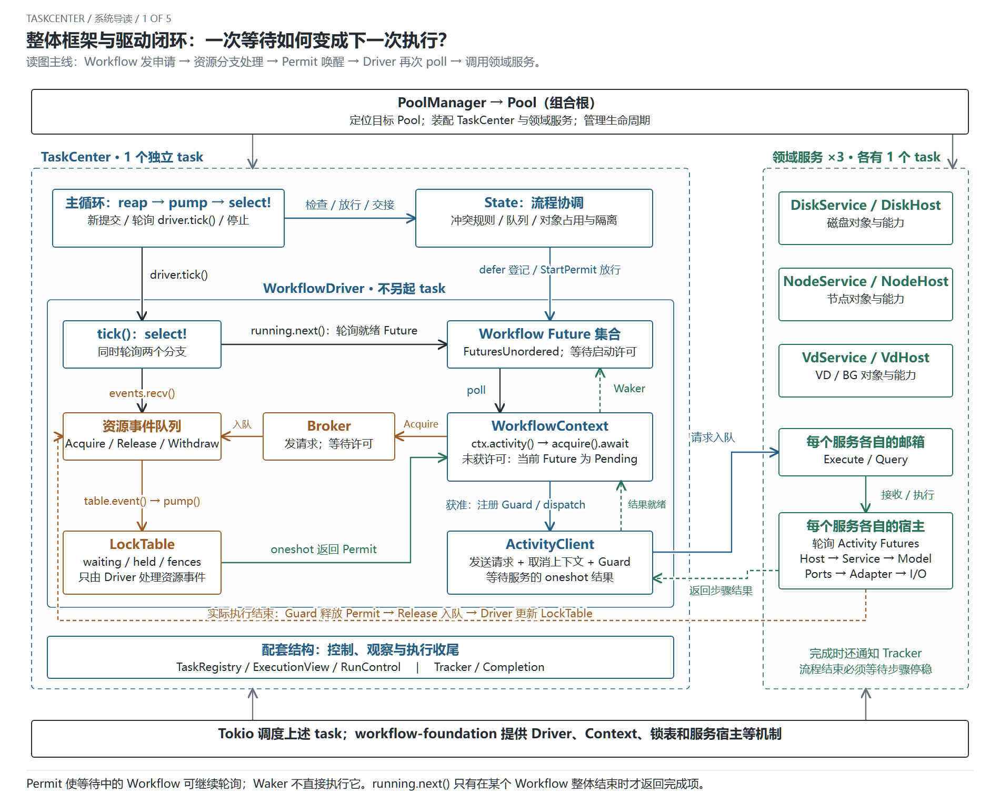
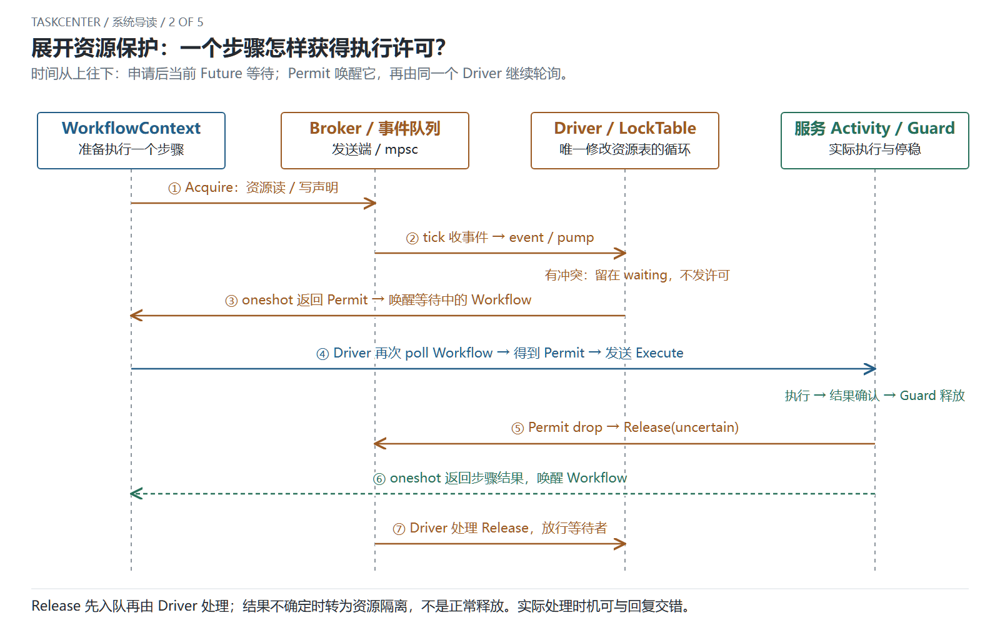
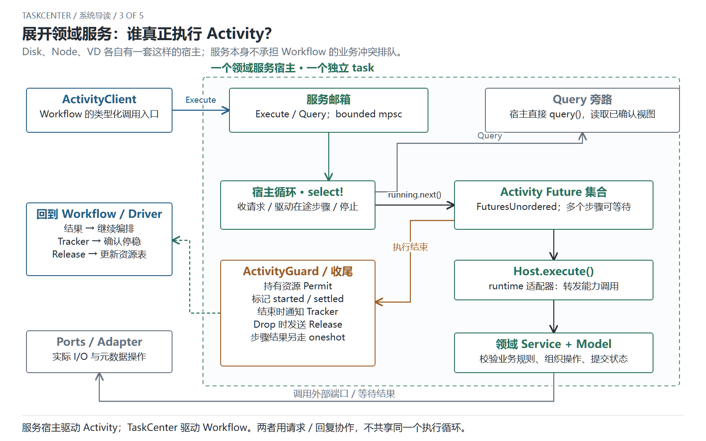
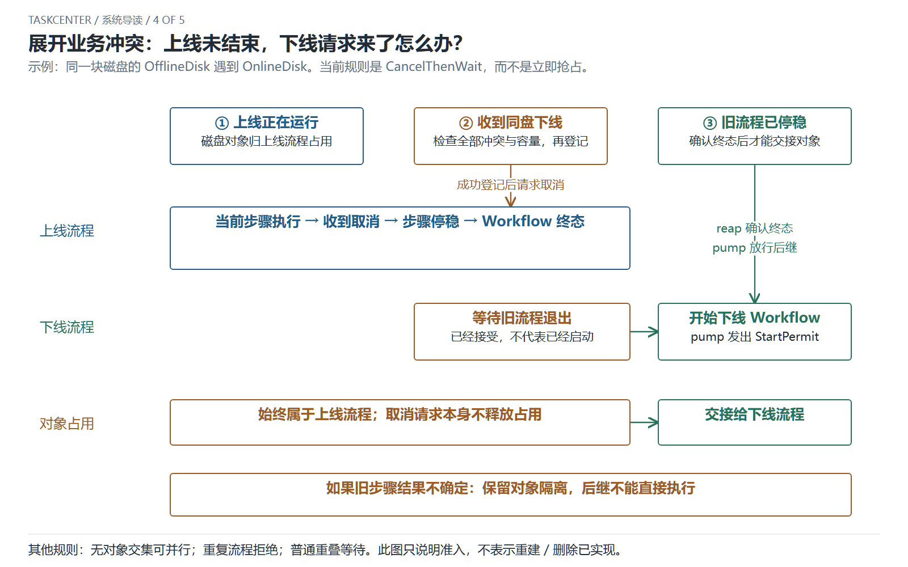
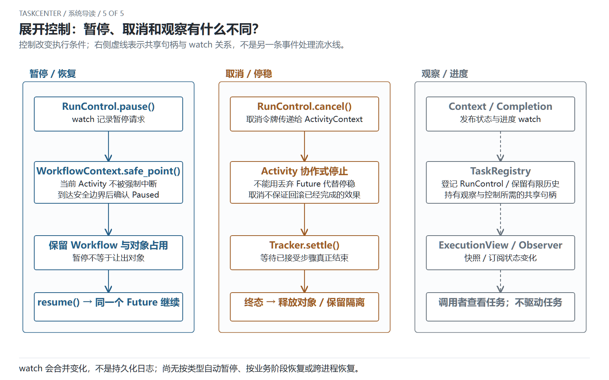

# TaskCenter 系统导读：从总览到执行细节

[打开五图导读：支持翻页、缩放和打印](diagrams/task-center-guide/index.html)

面向首次了解系统的开发者。先读第一张，再按需要展开后四张。
图中的 task 指 Tokio task，不代表专属操作系统线程。
本次只增加说明，不修改执行语义；实现依据为 `7b3b408` 的 Rust 代码。

## 1. 整体框架与驱动闭环

Pool 负责装配；TaskCenter 决定流程准入并推进 Workflow；各领域服务独立执行 Activity。
Driver、Broker、LockTable、Context 都不是额外的执行 task。

这里最重要的关系是资源分支与 Workflow 分支共享同一个驱动器：

1. 外层循环轮询 `driver.tick()`，其中 `running.next()` 轮询就绪的 Workflow Future。
2. Workflow 在 `ctx.activity()` 内通过 Broker 把 Acquire 发入资源事件队列。
3. 没有立即可用的 Permit 时，等待的 Future 返回 Pending；这不是阻塞线程或阻塞整个 TaskCenter。
4. 资源队列就绪，Driver 通过 `events.recv()` 取得事件并调用 `LockTable.event()`；锁表决定立即放行或继续排队。
5. 放行通过 oneshot 发回 Permit，唤醒等待链。FuturesUnordered 将对应 Future 标记为可再次轮询，并向外传播唤醒。
6. Tokio 再次调度 TaskCenter 后，由 Driver 继续 poll Workflow；它取到 Permit，注册 Guard，再调用 ActivityClient。
7. 服务的结果也通过 oneshot 唤醒同一条等待链，Workflow 才能解释结果并推进下一步骤。

唤醒是“可以再次轮询”的通知，不是 LockTable 或服务宿主直接执行 Workflow。
`running.next()` 被轮询时会推进内部 Future，但仅当一个 Workflow 整体完成时返回
`Ready(Some(id))`；步骤完成、拿到许可都不意味着 Workflow 已经结束。
资源事件分支每处理一个事件便结束这一轮 tick，外层循环随后再次进行 reap / pump / select。

Permit 接收等待封装在 Broker.acquire() 内；总览将其画到 WorkflowContext，是为了表达所属执行链，
不是 Context 越过 Broker 直接操作 LockTable。

[SVG 原图](diagrams/task-center-guide/01-overview.svg)

## 2. 资源许可：请求、等待、放行、释放

这是 Activity 的读写资源保护，不是完整 Workflow 的业务对象准入。
Broker 发送事件，LockTable 只由 Driver 更新，服务携带 Guard 执行。
Guard/Permit 的生命周期跟随实际执行，不跟随调用方是否还在等待结果。
Release 先入队；Driver 处理它的时机可以和服务回复交错。不确定结果保留资源隔离。

[SVG 原图](diagrams/task-center-guide/02-resources.svg)

## 3. 领域服务：步骤究竟在哪里执行

每个服务拥有自己的邮箱、宿主循环和 Activity Future 集合。
宿主经 Host 适配器调用 Service 与 Model，再通过端口访问外部依赖。
资源放行发生在步骤进入服务之前，领域服务不维护 Workflow 业务冲突队列。
Query 同样由服务宿主接收，但直接读取已确认视图，不作为业务编排步骤取得 Activity 许可。

例子：磁盘上线是一个 Workflow，不是 Add、Open 两个 Workflow。
它依次通过 Activity 检查节点服务资格、Add、Open、SetIo(Up)；任一步失败都会停止正常后续步骤。
其中 Node Inspect 也走 Activity，不以观察 Query 替代有业务意义的步骤。

[SVG 原图](diagrams/task-center-guide/03-services.svg)

## 4. 冲突交接：同一磁盘上线未结束，又收到下线

当前 `OfflineDisk` 遇到同盘 `OnlineDisk` 的规则为 CancelThenWait。
必须先检查全部冲突与容量、成功登记新任务，再请求取消旧任务。
取消请求本身不释放对象；只有旧流程与已接受步骤停稳后，才可能移交给后继。
结果不确定时保留隔离，不能把“没有成功结果”当作“可以开始另一个流程”。

其他规则包括无对象交集独立、重复拒绝、普通重叠等待。
实际对象集合可能包含节点，因此“磁盘不同”不自动意味着没有冲突。
此图展示调度语义，不表示下线流程的真实重建或删除已全部实现。

[SVG 原图](diagrams/task-center-guide/04-handoff.svg)

## 5. 控制：暂停、取消与观察

暂停在安全边界确认，不强制中断已发出的 Activity，仍保留 Workflow 的对象占用。
恢复继续当前进程内的同一个执行，不是重放或跨进程恢复。
取消通过令牌传递到步骤，并等待实际停稳；不自动回滚已经完成的效果。
TaskRegistry、ExecutionView、Observer 是共享状态与控制句柄的访问关系，不是新的事件处理管道。
watch 会合并更新，不能被当作无损或持久化的业务日志。

按类型自动暂停、按业务阶段恢复、持久化重放与跨进程恢复仍未实现。

[SVG 原图](diagrams/task-center-guide/05-control.svg)

## 源码与进一步阅读

- [Pool 装配](../crates/storage-pool/src/pool.rs)
- [TaskCenter 的 State 与外层循环](../crates/storage-pool/src/task_center/mod.rs)
- [具体冲突规则](../crates/storage-pool/src/task_center/conflicts.rs)
- [Driver 的 tick / defer](../crates/workflow-foundation/src/driver.rs)
- [Broker、LockTable 与 Permit](../crates/workflow-foundation/src/locks.rs)
- [WorkflowContext、Tracker 与执行包装](../crates/workflow-foundation/src/workflow.rs)
- [ActivityClient 与服务宿主](../crates/workflow-foundation/src/service.rs)
- [磁盘上线 Workflow](../crates/storage-pool/src/workflows/online_disk.rs)
- [单张完整协作图：适合查实现](runtime-collaboration.md)

## 本次交付与验收

范围：把原来的总览和 Driver 图合并，并细化资源申请、Pending、许可唤醒和再次轮询；
后四张分别展开资源、服务、冲突与控制。不修改 Rust、依赖或业务行为。

验收：第一张同时呈现核心组件、内部结构和主要运行闭环；后续每张回答一个具体问题；
不同 task 的边界、对象占用和步骤资源保护不混淆；未实现能力不画成已实现。

交付：五份可编辑 SVG、五份 PNG，以及无需联网或安装依赖的 HTML 导读。
验证通过：源码对照、浏览器渲染与逐图检查；五份 SVG XML、文档链接和 HTML 嵌入一致性检查；
真实浏览器检查五页切换、页签/hash、上一页、键盘翻页、缩放、画布边界与唯一 DOM id。
外围工程 `npm run verify` 通过（Harness、lint、TypeScript 和生产构建）。未修改 Rust，未重跑 Rust 测试。
