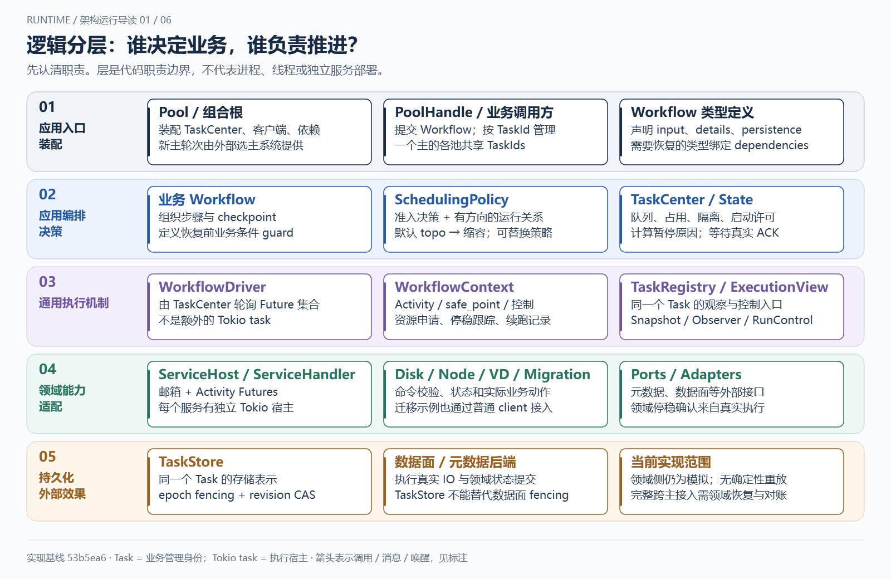
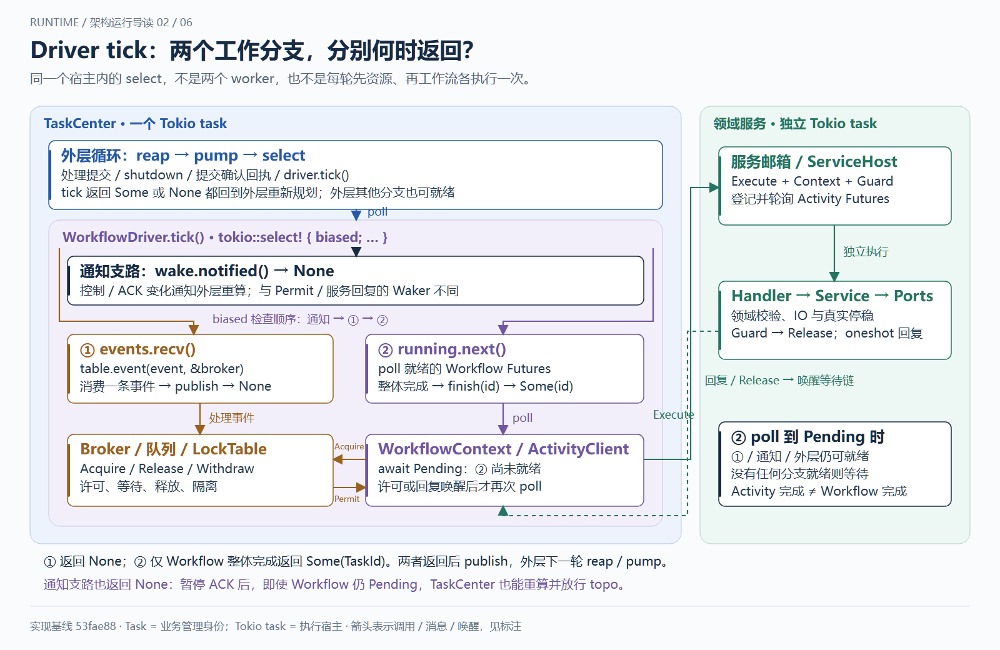
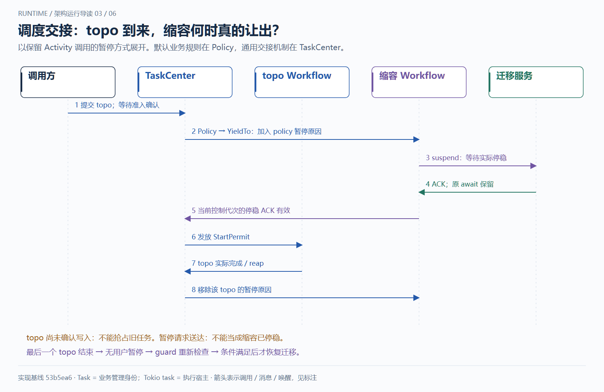
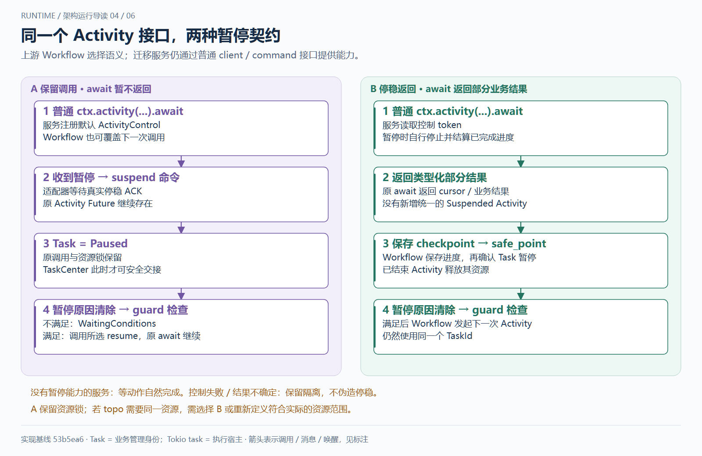
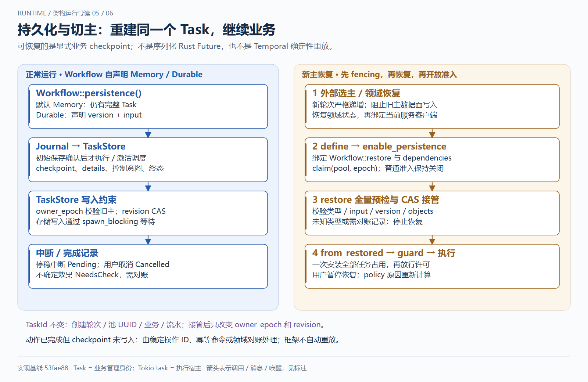
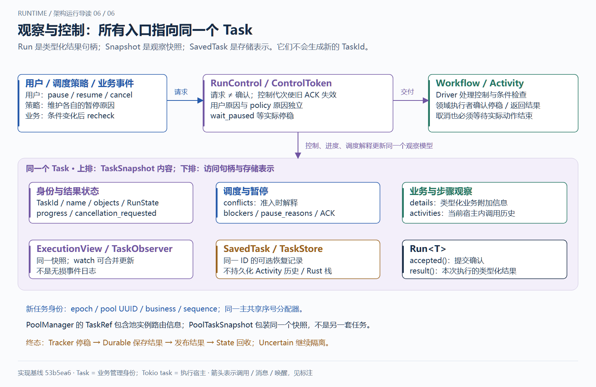

# 运行图导读：统一 Task、调度与恢复（53fae88 快照）

**这些图保留 53fae88 的两种暂停与 priority/relation 机制；当前代码已经简化为单一规则和停稳返回，详见 [当前控制链](task-center.md)。**

**想回看当时的请求流转：打开 [Runtime Lab 动态演示](diagrams/task-center-simulation/index.html)。**

[打开交互导读](diagrams/unified-task-guide/index.html)：六图翻页、运行步骤高亮、组件职责查询、缩放与打印，离线可用。

本组图按实现提交 `53fae88` 重绘。Task 是业务管理身份；Tokio task 是执行宿主。
逻辑分层不等于部署拆分；TaskCenter 与各服务宿主的实际执行边界见第二图。

## 1. 逻辑分层：各组件负责什么

- 应用入口和组合根装配依赖、主轮次分配器、TaskCenter 与领域客户端。
- Workflow 定义步骤、持久化、checkpoint、附加信息和继续执行的业务条件。
- SchedulingPolicy 定义跨任务关系；TaskCenter 管队列、占用、隔离与停稳交接。
- Driver 推进 Future，Context 提供 Activity 与控制机制。两者不是额外的 Tokio task。
- 领域服务负责命令合法性和真实动作；TaskStore 保存同一个 Task 的恢复记录。

[可编辑 SVG](diagrams/unified-task-guide/01-layers.svg)

## 2. 实际执行：一次 Activity 如何推进和返回

动态图已将两个工作分支上下排列，并持续标出 Pending Future 的宿主、具体资源事件和锁表分派；
见 [等待现场说明](changes/2026-10-24-runtime-awaits.md)。静态图用于概览职责。

TaskCenter 的循环处理提交、关闭、提交确认回执和 driver.tick()。Driver 同时轮询 Workflow
Future 集合及资源事件；Workflow 等待资源或服务结果时返回 Pending，不阻塞整个循环。
Context 经 Broker 请求资源，LockTable 在 Driver 内处理事件并发回 Permit。取得许可后，
ActivityClient 将请求、Context、Guard 发送到服务邮箱。服务宿主独立轮询执行 Future，
调用 Handler → Service → Ports。Guard 跟随实际执行停稳，再通知 Tracker 并投递 Release。

服务的 oneshot 回复唤醒原等待链；是 Tokio 再次调度 TaskCenter 后继续 poll Workflow，
不是服务宿主直接执行 Workflow。Workflow 整体完成后，State 才回收对象或保留 Uncertain 隔离。
第二图将 tick 中的两个工作分支并排展示：

- ① `events.recv()`：消费一条资源事件，调用 `table.event`，发布快照后返回 `None`。
- ② `running.next()`：轮询就绪 Workflow；等待 Activity 时仍为 Pending，整体结束才执行 `finish(id)` 并返回 `Some(TaskId)`。
- 独立通知支路 `wake.notified()`：控制或 ACK 变化让 tick 返回 `None`，外层重新 `reap / pump`。

代码采用 biased select，检查顺序是通知、资源、工作流。它们在同一个宿主内被轮询，
不是三个独立 worker，也不是每个 tick 都依次执行各分支体。普通 Permit / 服务回复的 Waker
只唤醒等待链，不能与上述通知支路的返回混为一谈。

[可编辑 SVG](diagrams/unified-task-guide/02-runtime.svg)

## 3. 调度：topo 如何暂停缩容并取得执行权

默认 PoolSchedulingPolicy 声明缩容 YieldTo topo。TaskCenter 先完成准入；Durable 任务还须
确认初始记录写入，才激活调度并影响既有任务。暂停原因写入同一个 Task 的控制状态。
迁移实际停稳、当前控制代次 ACK 有效后，TaskCenter 才发放 topo Workflow 的 StartPermit。
许可发给流程执行体，不交给外部调用者。

topo 完成只清除它自己的暂停原因；其他 topo 或用户暂停仍有效。全部原因清除后，Workflow
重新检查继续执行的业务条件。用户 resume 不能绕过仍在运行的 topo。
此图采用当前 ShrinkWorkflow 的停稳返回方式：BalanceHost 等待 C completion，
返回 `ActivityExit::Suspended(checkpoint)`；Workflow 保存续作数据后进入 `wait_until_runnable()` 确认暂停。

旧 FIFO 会形成“缩容等 topo、topo 等早到的卷任务、卷任务等缩容”的等待环。
默认策略现在使用 `topo(2) > 其他(1) > shrink(0)`，同级 FIFO；
topo 可越过尚未启动的卷任务，但仍须等缩容真实停稳。运行中的 Exclusive 占用不会被优先级抢走。
动画的「三任务等待环」对照展示旧环与新计划；自定义 priority 与 YieldTo 仍须保持一致。

[可编辑 SVG](diagrams/unified-task-guide/03-scheduling.svg)

## 4. 暂停：原 await 保留，还是先返回部分结果

两种方式都使用原有 ctx.activity(...).await，TaskId 不变。

- 保留调用：ActivityControl 发送领域 suspend 命令并等待停稳。原 await 继续等待；
  暂停原因清除后，Workflow RunCondition 先检查，满足才执行所选 resume 命令。
- 停稳返回：服务观察控制 token，自行停稳后返回 ActivityExit::Suspended(checkpoint)。Workflow 保存 checkpoint，
  再进入 wait_until_runnable 确认 Task 暂停；恢复并通过 RunCondition 后发起下一次普通 Activity。

Workflow 可覆盖下一次调用的控制适配器，因此缩容和扩容可以选择不同领域命令。
完全不支持暂停的服务需等自然完成。保留调用仍持有 Activity 资源锁，topo 若需要同一资源，
应选停稳返回方式或调整真实资源边界。控制失败不会被当成成功停稳。

[可编辑 SVG](diagrams/unified-task-guide/04-pause.svg)

## 5. 切主：恢复同一 Task 的业务进度

Workflow 自声明 Memory 或 Durable。持久化流程通过 Journal 保存 input/version、checkpoint、
details、对象、控制意图和终态；TaskStore 校验 owner_epoch 与 revision，写入走 spawn_blocking。

新主先获得严格递增的轮次、完成数据面 fencing 与领域恢复，再绑定 Workflow 定义和依赖，
claim 存储、全量预检待恢复记录并 CAS 接管。TaskCenter::from_restored 一次装回全部任务占用，
之后才放行许可。恢复保留原 TaskId 和用户暂停，policy 暂停原因重新计算。
未知类型、版本不匹配、NeedsCheck 或待核对取消记录会阻止恢复，不能静默丢弃旧占用。

这是 checkpoint 重建，不是恢复 Rust 栈或确定性事件重放。远端动作完成而 checkpoint 未写入的
窗口需要业务幂等键或对账；TaskStore 的 fencing 不能替代数据面 fencing。默认 PoolManager
业务仍为内存运行，完整生产切主还需要实际后端和领域接入。

[可编辑 SVG](diagrams/unified-task-guide/05-recovery.svg)

## 6. 观察：一个 Task，多种访问方式

TaskSnapshot 汇总身份、执行状态、进度、业务 details、Activity 历史和调度解释；conflicts
是准入解释，blockers 是实时阻塞者。ExecutionView / TaskObserver 访问同一个观察模型，
Run 等提交确认和类型化结果，SavedTask 是该 Task 的可选存储表示。

PoolTaskSnapshot 只是既有多池路由信封；不生成另一个任务 ID、不维护第二个状态机。
观察通知可以合并；Activity 历史仅属于当前宿主，不作为跨恢复幂等键或持久事件日志。

[可编辑 SVG](diagrams/unified-task-guide/06-observation.svg)

## 源码与验证

- [TaskCenter 与调度激活](../crates/storage-pool/src/task_center/mod.rs)
- [默认业务策略](../crates/storage-pool/src/task_center/conflicts.rs)、[通用关系规划](../crates/workflow-foundation/src/scheduling.rs)
- [Driver](../crates/workflow-foundation/src/driver.rs)、[Context 与收尾](../crates/workflow-foundation/src/workflow.rs)
- [暂停与继续执行](../crates/workflow-foundation/src/workflow/control.rs)、[控制代次与 ACK](../crates/workflow-foundation/src/control.rs)
- [服务宿主](../crates/workflow-foundation/src/service.rs)、[资源机制](../crates/workflow-foundation/src/locks.rs)
- [恢复](../crates/workflow-foundation/src/driver/recovery.rs)、[存储](../crates/workflow-foundation/src/persistence.rs)
- [统一观察](../crates/workflow-foundation/src/tasks.rs)、[缩容接入示例](../crates/storage-pool/examples/managed_shrink.rs)
- [图示规格与验证记录](changes/2026-10-24-runtime-guide.md)、[tick 分支与死锁回归图示](changes/2026-10-24-driver-tick-views.md)

旧版五图与单张协作图保留作历史资料，不代表新架构的全部控制和持久化能力。
